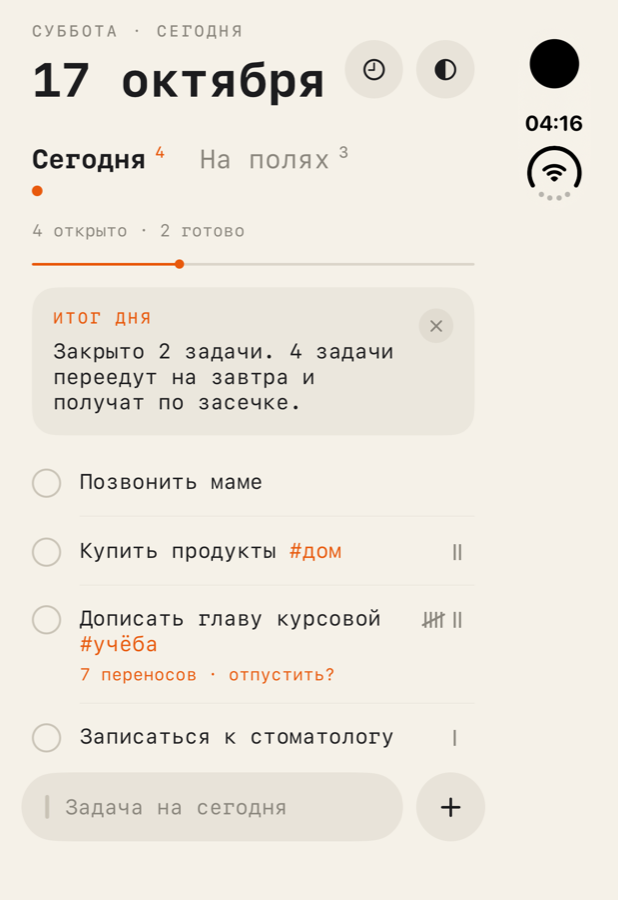
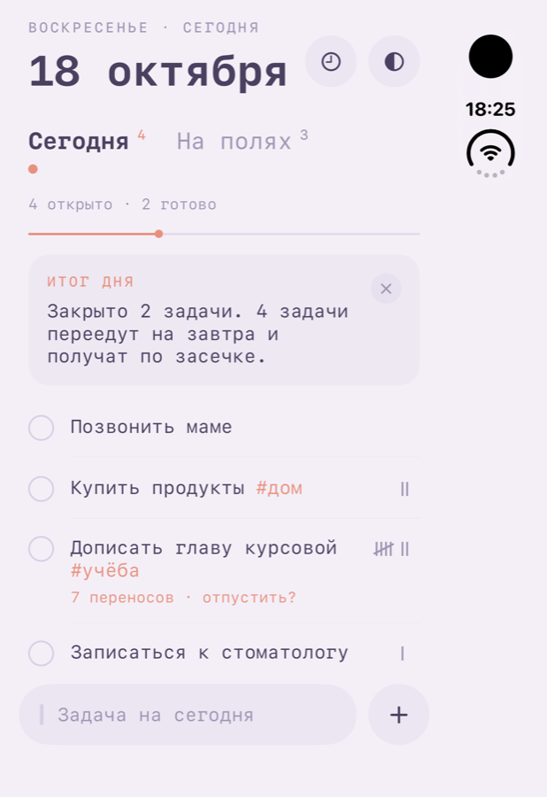
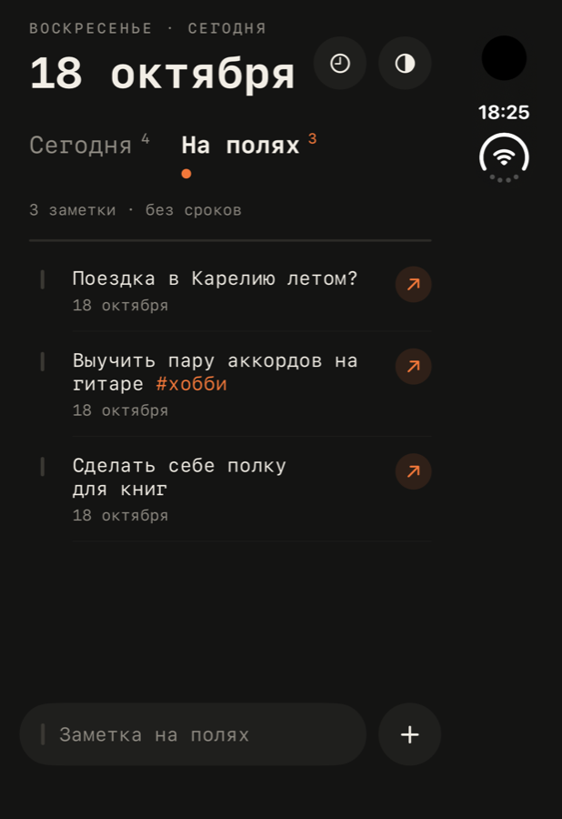

<p align="center">
  
</p>

<h1 align="center">Tick</h1>

<p align="center">
  Минималистичный планировщик на один день для iPhone и Mac.<br>
  Один день, один список и никакого давления.
</p>

<p align="center">
  
  
  
</p>

## Что умеет

- **Один день — один список.** Нет проектов, приоритетов и фильтров: только то, что нужно сделать сегодня.
- **Засечки.** Невыполненные задачи сами переносятся на следующий день и получают засечку `|`. Пятая перечёркивает четыре, как на бумаге.
- **«Отпустить?»** Если задача переехала пять раз и больше, Tick мягко предлагает её отпустить: удалить или унести на поля. Без чувства вины.
- **На полях.** Место для того, что ещё не стало задачей: идеи, «когда-нибудь», мысли вслух. Любую заметку можно одним нажатием сделать задачей на сегодня.
- **Итог дня.** Вечером короткая карточка: сколько закрыто и сколько задач переедет на завтра.
- **#теги прямо в тексте.** Нажатие на тег показывает все задачи с ним.
- **История.** Прошлые дни такими, какими вы их оставили: что сделано и что перенесено.
- **Резервная копия.** Все задачи и заметки сохраняются в один файл. Через него же Tick переносится с iPhone на Mac и обратно; повторная загрузка не создаёт дублей.
- **Три темы:** светлая, тёмная и пастельная, а также «как в системе».
- **Мелочи:** анимированная галочка, лёгкая вибрация, заставка, моноширинный шрифт, русский интерфейс.
- **Без аккаунтов и слежки.** Данные хранятся только на устройстве.

## Как собрать

Нужны Xcode 26 или новее и [XcodeGen](https://github.com/yonaskolb/XcodeGen).

```bash
brew install xcodegen
cd Zasechki
xcodegen generate
open Zasechki.xcodeproj
```

Перед запуском на своём iPhone поменяйте в `Zasechki/project.yml` значения `DEVELOPMENT_TEAM` (ваша команда в Xcode → Settings → Apple Accounts) и `PRODUCT_BUNDLE_IDENTIFIER`, затем снова выполните `xcodegen generate`. Бесплатного Apple ID достаточно; в этом случае приложение нужно переустанавливать из Xcode раз в 7 дней.

## Устройство проекта

```
Zasechki/
  project.yml          описание проекта для XcodeGen
  Sources/
    Model/             данные (SwiftData) и логика дней, переносов и тегов
    Views/             экраны и компоненты SwiftUI, темы, заставка
  Tools/make_icons.swift  рисует иконку во всех размерах
```

Перенос задач не записывается в базу, а вычисляется по датам: у задачи есть день создания, день выполнения и день удаления. Поэтому список «Сегодня», засечки и история всегда согласованы.

## Благодарности

Идея вдохновлена приложением [Tally](https://apps.apple.com/app/id6792468214).

---

## Лицензия

[PolyForm Noncommercial 1.0.0](LICENSE.md). Код можно читать, изучать, менять и использовать в личных, учебных и других некоммерческих целях. **Коммерческое использование запрещено**: продавать Tick, его части или основанные на нём приложения, а также использовать код в коммерческих продуктах нельзя без письменного разрешения автора.

---

<p align="center"><sub>made by <a href="https://github.com/shok1o">shok1o</a></sub></p>
